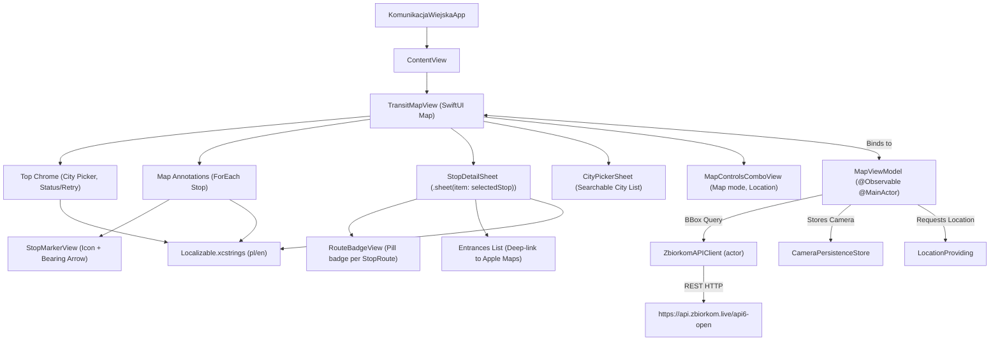

# Architecture Guide

This document describes the software architecture, state flow, MapKit integration, and future expansion roadmap for the `KomunikacjaWiejska` native iOS app.

---

## 1. Architectural Principles

1. **Native-First Design:**
   - Pure Apple frameworks: `SwiftUI`, `MapKit`, `CoreLocation`, `Observation`, and `Foundation`.
   - Prefer Apple HIG idioms: Liquid Glass via native `.buttonStyle(.glass)` / `glassEffect` / `GlassEffectContainer`, SF Symbols, native MapKit controls (`MapCompass`), and standard bottom sheets (`.presentationDetents`).
   - The app never re-implements platform chrome (compass animations, glass buttons, map gestures).
2. **Observation & Swift Concurrency:**
   - View models use the Swift `@Observable` macro and `@MainActor`.
   - No Combine pipelines or `ObservableObject` classes.
   - Network interactions are actor-isolated (`ZbiorkomAPIClient: actor`) with `async`/`await`.
   - The app builds in **Swift 6 language mode** with `SWIFT_DEFAULT_ACTOR_ISOLATION = MainActor`. Pure value types used across actors (`BoundingBox`, model types, `StopsProviding`, `LocationProviding`) are explicitly `nonisolated`; no blanket `@preconcurrency` escapes.
3. **Optimized Map Performance:**
   - Public transit networks in metropolitan areas contain tens of thousands of stop poles.
   - Stops are fetched **per visible viewport**: `.onMapCameraChange(frequency: .onEnd)` debounces camera changes (`MapConstants.cameraDebounceNanoseconds`, 350 ms) and `MapViewModel` determines missing Web Mercator tiles.
   - Fetched stops live in a session-only, per-city tile cache using flat Zoom 12 Web Mercator tiles (`MapTile.zoom = 12`). There is no multi-level tile hierarchy; missing tiles are requested as a single union bounding box (`minLon,minLat,maxLon,maxLat`) and merged into the city cache by stop ID. The cache is cleared on city switch and never persisted.
   - Camera distance controls stop rendering thresholds:
     - **Full markers:** Camera distance $\le$ 6,000 m (`MapConstants.stopCompactDistanceThreshold`).
     - **Compact markers:** Camera distance between 6,000 m and 12,000 m (`MapConstants.stopVisibilityDistanceThreshold`).
     - **Hidden:** Stops hidden and fetches suppressed when camera distance exceeds 12,000 m.
   - When a viewport contains more than 250 visible stops (`MapConstants.maxRenderedStops`), `MapViewModel` thins them deterministically using a 2D spatial grid (retaining one representative per cell with smallest ID, and always preserving the currently selected stop) per ADR-0008.
   - Camera metrics are grouped into one atomic `CameraState` value, preventing unnecessary annotation redraws during unrelated camera movements.
4. **Localization & Accessibility:**
   - User-facing copy lives in `Resources/Localizable.xcstrings` with Polish (`pl`) and English (`en`) translations.
   - `MapMode` and `RouteType` keep locale-independent identifiers/raw values; display names are localized in the UI layer (`RouteType+UI.swift`).
   - Icon-only controls have accessibility labels, markers combine into one element, and the selected stop/route type is announced.

---

## 2. Component Hierarchy & Flow

---

## 3. Key Files & Responsibilities

### Models (`KomunikacjaWiejska/Models/`)
- [`RouteType.swift`](file:///Users/lemon/Documents/coding/KomunikacjaWiejska/KomunikacjaWiejska/Models/RouteType.swift):
  - GTFS route types (`tram`, `subway`, `rail`, `bus`, `ferry`, `aerialLift`, `funicular`, `trolleybus`, `monorail`, `unknown`).
- [`BoundingBox.swift`](file:///Users/lemon/Documents/coding/KomunikacjaWiejska/KomunikacjaWiejska/Models/BoundingBox.swift):
  - Calculates `minLon,minLat,maxLon,maxLat` from an `MKCoordinateRegion` for API requests.
- [`MapTile.swift`](file:///Users/lemon/Documents/coding/KomunikacjaWiejska/KomunikacjaWiejska/Models/MapTile.swift):
  - Flat Web Mercator tile math (`zoom = 12`) for session caching: visible tiles for a region, tile bounds, and union bbox computation.
- [`Stop.swift`](file:///Users/lemon/Documents/coding/KomunikacjaWiejska/KomunikacjaWiejska/Models/Stop.swift):
  - `Stop`, `StopRoute`, `StopEntrance` models.
  - Implements custom `Decodable` parsing of unkeyed positional arrays via `TupleReader`.
- [`City.swift`](file:///Users/lemon/Documents/coding/KomunikacjaWiejska/KomunikacjaWiejska/Models/City.swift):
  - Bundled catalog of 66 Polish cities and metropolitan networks, default coordinates, and `City.city(id:) -> City?`.

### Services & Persistence (`KomunikacjaWiejska/Services/`)
- [`ZbiorkomAPIClient.swift`](file:///Users/lemon/Documents/coding/KomunikacjaWiejska/KomunikacjaWiejska/Services/ZbiorkomAPIClient.swift):
  - Actor managing `URLSession` communication with `api.zbiorkom.live`.
  - Implements bounded retries with exponential backoff and jitter for transient errors.
- [`StopsProviding.swift`](file:///Users/lemon/Documents/coding/KomunikacjaWiejska/KomunikacjaWiejska/Services/StopsProviding.swift):
  - Injectable abstraction over the stops data source; `ZbiorkomAPIClient` conforms so `MapViewModel` can be tested hermetically with stubs.
- [`LocationProviding.swift`](file:///Users/lemon/Documents/coding/KomunikacjaWiejska/KomunikacjaWiejska/Services/LocationProviding.swift) & [`LocationManager.swift`](file:///Users/lemon/Documents/coding/KomunikacjaWiejska/KomunikacjaWiejska/Services/LocationManager.swift):
  - Protocol and implementation wrapping `CLLocationManager` with a 15-second bounded one-shot fix timeout and authorization state handling.
- [`CameraPersistenceStore.swift`](file:///Users/lemon/Documents/coding/KomunikacjaWiejska/KomunikacjaWiejska/Services/CameraPersistenceStore.swift):
  - Protocol for camera state storage with `UserDefaultsCameraPersistenceStore` (production) and `InMemoryCameraPersistenceStore` (tests).

### Constants & Design (`KomunikacjaWiejska/Constants/`)
- [`MapConstants.swift`](file:///Users/lemon/Documents/coding/KomunikacjaWiejska/KomunikacjaWiejska/Constants/MapConstants.swift):
  - Centralized thresholds (6 km compact / 12 km visibility), 250 max stops cap, 350 ms debounce, 15 s location timeout.
- [`DesignTokens.swift`](file:///Users/lemon/Documents/coding/KomunikacjaWiejska/KomunikacjaWiejska/Constants/DesignTokens.swift):
  - Spacing, icon sizes, sheet detents, and minimum 44pt touch target metrics.

### Extensions (`KomunikacjaWiejska/Extensions/`)
- [`Color+Hex.swift`](file:///Users/lemon/Documents/coding/KomunikacjaWiejska/KomunikacjaWiejska/Extensions/Color+Hex.swift):
  - Failable `Color(hex:)` for 3-, 6-, and 8-digit strings, plus WCAG relative luminance contrast calculation (`isLightColor`).
- [`RouteType+UI.swift`](file:///Users/lemon/Documents/coding/KomunikacjaWiejska/KomunikacjaWiejska/Extensions/RouteType+UI.swift):
  - SwiftUI color, SF Symbols, and localized display names for `RouteType` per ADR-0004.

### Presentation (`KomunikacjaWiejska/ViewModels/` & `Views/`)
- [`MapViewModel.swift`](file:///Users/lemon/Documents/coding/KomunikacjaWiejska/KomunikacjaWiejska/ViewModels/MapViewModel.swift):
  - Central `@Observable` state holder. Manages camera position, selected city, flat Zoom 12 session tile cache, visible thinned stops, active stop selection, typed `FetchState`, localized errors, and cancellation of pending network tasks.
- [`TransitMapView.swift`](file:///Users/lemon/Documents/coding/KomunikacjaWiejska/KomunikacjaWiejska/Views/TransitMapView.swift):
  - Root map screen with MapKit standard layer (POI disabled), safe-area-aware top chrome, and retryable status capsule.
- [`StopMarkerView.swift`](file:///Users/lemon/Documents/coding/KomunikacjaWiejska/KomunikacjaWiejska/Views/StopMarkerView.swift):
  - Unified transit marker displaying transit icon, platform badge, bearing arrow, and supporting compact mode.
- [`StopDetailSheet.swift`](file:///Users/lemon/Documents/coding/KomunikacjaWiejska/KomunikacjaWiejska/Views/StopDetailSheet.swift):
  - Non-blocking bottom sheet displaying platform number, direction, route chips with contrast-safe text, and entrance deep-links.
- [`CityPickerSheet.swift`](file:///Users/lemon/Documents/coding/KomunikacjaWiejska/KomunikacjaWiejska/Views/CityPickerSheet.swift):
  - Searchable list of Polish cities allowing the user to switch transit networks.
- [`MapControlsComboView.swift`](file:///Users/lemon/Documents/coding/KomunikacjaWiejska/KomunikacjaWiejska/Views/MapControlsComboView.swift):
  - Floating Liquid Glass control combo for map mode and user location tracking.

### Resources (`KomunikacjaWiejska/Resources/`)
- `Localizable.xcstrings` — Polish and English copy (map chrome, errors, stop sheet, accessibility).
- `InfoPlist.xcstrings` — localized system permission prompts (location usage description).
- `cities.json` — the bundled 66-network city catalog.
- `DesignTokens.swift` — shared spacing, control, and marker metrics.
- [`StopMarkerView.swift`](file:///Users/lemon/Documents/coding/KomunikacjaWiejska/KomunikacjaWiejska/Views/StopMarkerView.swift):
  - Circular transit badge showing transit icon and a triangle notch rotated to the stop's `bearing`.
- [`StopDetailSheet.swift`](file:///Users/lemon/Documents/coding/KomunikacjaWiejska/KomunikacjaWiejska/Views/StopDetailSheet.swift):
  - Non-blocking bottom sheet showing platform number, direction, and route chips.
- [`CityPickerSheet.swift`](file:///Users/lemon/Documents/coding/KomunikacjaWiejska/KomunikacjaWiejska/Views/CityPickerSheet.swift):
  - Searchable list of Polish cities allowing the user to jump between transit networks.

---

## 4. Future Roadmap

1. **Stop Departures (Milestone 2):**
   - Query `GET /api6-open/{city}/stops/{stopId}` when a stop is selected.
   - Display real-time departure countdowns, delays in minutes, and cancellations.
2. **Live Vehicle Positions (Milestone 3):**
   - Poll `GET /api6-open/{city}/positions/{bbox}` periodically (e.g., every 3-5s).
   - Render animated vehicle markers on the map with route numbers and bearings.
3. **Trip Route Polyline & Vehicle Trace (Milestone 4):**
   - Query `GET /api6-open/{city}/trips/{tripId}` or route geometries to draw transit lines using `MapPolyline`.
