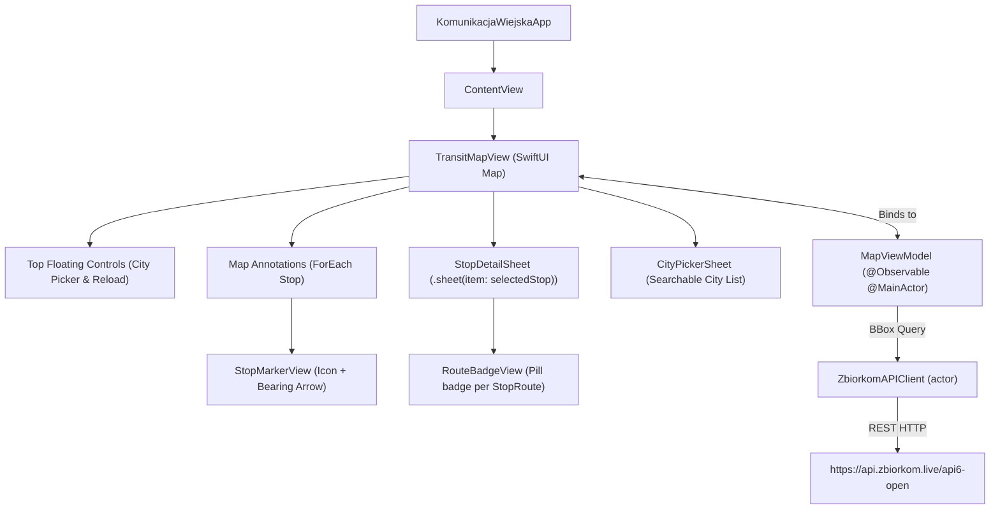

# Architecture Guide

This document describes the software architecture, state flow, MapKit integration, and future expansion roadmap for the `KomunikacjaWiejska` native iOS app.

---

## 1. Architectural Principles

1. **Native-First Design:**
   - Pure Apple frameworks: `SwiftUI`, `MapKit`, `CoreLocation`, `Observation`, and `Foundation`.
   - Prefer Apple HIG idioms: glass materials (`.ultraThinMaterial`), SF Symbols, native MapKit controls, and standard bottom sheets (`.presentationDetents`).
2. **Observation & Swift Concurrency:**
   - View models use the Swift `@Observable` macro and `@MainActor`.
   - No Combine pipelines or `ObservableObject` classes.
   - Network interactions are actor-isolated (`ZbiorkomAPIClient: actor`) with `async`/`await`.
3. **Optimized Map Performance:**
   - Public transit networks in metropolitan areas contain tens of thousands of stop poles.
   - Stops are fetched **per visible viewport**: `.onMapCameraChange(frequency: .onEnd)` debounces camera changes (350 ms) and `MapViewModel` passes the viewport bounding box (`minLon,minLat,maxLon,maxLat`) to the backend.
   - Viewport results are cached in memory with a 10-minute TTL and LRU eviction (8 entries); failures and empty results are never cached.
   - When a viewport returns more than 250 stops, `MapViewModel` thins them deterministically (one representative per grid cell) before rendering.

---

## 2. Component Hierarchy & Flow

---

## 3. Key Files & Responsibilities

### Models (`KomunikacjaWiejska/Models/`)
- [`RouteType.swift`](file:///Users/lemon/Documents/coding/KomunikacjaWiejska/KomunikacjaWiejska/Models/RouteType.swift):
  - GTFS route types (`tram`, `subway`, `rail`, `bus`, `ferry`, `aerialLift`, `funicular`, `trolleybus`, `monorail`).
  - Maps route types to SF Symbols (`tram.fill`, `bus.fill`, etc.) and brand colors.
- [`BoundingBox.swift`](file:///Users/lemon/Documents/coding/KomunikacjaWiejska/KomunikacjaWiejska/Models/BoundingBox.swift):
  - Calculates `minLon,minLat,maxLon,maxLat` from an `MKCoordinateRegion` for API requests.
- [`Stop.swift`](file:///Users/lemon/Documents/coding/KomunikacjaWiejska/KomunikacjaWiejska/Models/Stop.swift):
  - `Stop`, `StopRoute`, `StopEntrance` models.
  - Implements custom `Decodable` parsing of the unkeyed positional arrays (`unkeyedContainer()`).
- [`City.swift`](file:///Users/lemon/Documents/coding/KomunikacjaWiejska/KomunikacjaWiejska/Models/City.swift):
  - Static catalog of supported Polish cities, default coordinates, and map spans.

### Networking (`KomunikacjaWiejska/Services/`)
- [`ZbiorkomAPIClient.swift`](file:///Users/lemon/Documents/coding/KomunikacjaWiejska/KomunikacjaWiejska/Services/ZbiorkomAPIClient.swift):
  - Actor managing `URLSession` communication with `api.zbiorkom.live`.
  - Encapsulates error parsing (`ZbiorkomAPIError`).
- [`StopsProviding.swift`](file:///Users/lemon/Documents/coding/KomunikacjaWiejska/KomunikacjaWiejska/Services/StopsProviding.swift):
  - Injectable abstraction over the stops data source; `ZbiorkomAPIClient` conforms so `MapViewModel` can be built with a stub in tests.

### Extensions (`KomunikacjaWiejska/Extensions/`)
- [`Color+Hex.swift`](file:///Users/lemon/Documents/coding/KomunikacjaWiejska/KomunikacjaWiejska/Extensions/Color+Hex.swift):
  - Initializer for `Color(hex:)` supporting 3-, 6-, and 8-digit hex strings for route and vehicle badge styling.

### Presentation (`KomunikacjaWiejska/ViewModels/` & `Views/`)
- [`MapViewModel.swift`](file:///Users/lemon/Documents/coding/KomunikacjaWiejska/KomunikacjaWiejska/ViewModels/MapViewModel.swift):
  - Central `@Observable` state holder. Manages camera position, selected city, visible stops, active stop selection, and cancellation of pending network tasks.
- [`TransitMapView.swift`](file:///Users/lemon/Documents/coding/KomunikacjaWiejska/KomunikacjaWiejska/Views/TransitMapView.swift):
  - Root map screen with MapKit standard layer (POI disabled for clarity).
- [`StopMarkerView.swift`](file:///Users/lemon/Documents/coding/KomunikacjaWiejska/KomunikacjaWiejska/Views/StopMarkerView.swift):
  - Circular transit badge showing transit icon and a triangle notch rotated to the stop's `bearing`.
- [`StopDetailSheet.swift`](file:///Users/lemon/Documents/coding/KomunikacjaWiejska/KomunikacjaWiejska/Views/StopDetailSheet.swift):
  - Non-blocking bottom sheet showing platform number, direction, and route chips.
- [`CityPickerSheet.swift`](file:///Users/lemon/Documents/coding/KomunikacjaWiejska/KomunikacjaWiejska/Views/CityPickerSheet.swift):
  - Searchable list of Polish cities allowing the user to jump between transit networks.

---

## 4. Future Roadmap

1. **Stop Departures (Milestone 2):**
   - Query `GET /api6-open/{city}/stops/{stopId}` when a stop is selected.
   - Display real-time departure countdowns, delays in minutes, and cancellations.
2. **Live Vehicle Positions (Milestone 3):**
   - Poll `GET /api6-open/{city}/positions/{bbox}` periodically (e.g., every 3-5s).
   - Render animated vehicle markers on the map with route numbers and bearings.
3. **Trip Route Polyline & Vehicle Trace (Milestone 4):**
   - Query `GET /api6-open/{city}/trips/{tripId}` or route geometries to draw transit lines using `MapPolyline`.
